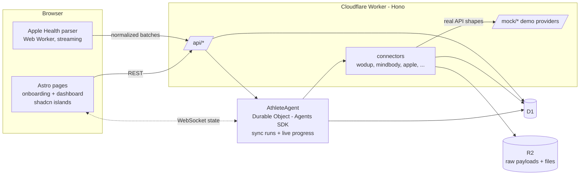

# OpenHealth — Technical Specification

Version 0.2 · 2026-10-27 · Status: draft for review
Implements [PRD v2](PRD.md). Every work item maps to a PRD requirement ID.
Related: [Story Playbook](STORY-PLAYBOOK.md) · [Decisions](DECISIONS.md) · [Fixtures](../fixtures/README.md)

## 0. Build order

| Phase | Goal | PRD IDs |
|---|---|---|
| **A. Data infrastructure** | Connectors, schema, database, sync and reconciliation: two years of data from three sources in one store with provenance | H1, H2, H11, H12, A1–A3 |
| **B. Onboarding and first dashboard** | Create a profile, connect accounts, watch the sync, land on the first dashboard, resolve reviews | B1–B5 |
| **C. Story engine** | Analyst → desk → fact-check → video (§11) | H3–H10 |

Phases A and B are the current focus. Phase C stays specified so A and B don't paint it into a corner.

## 1. Architecture



**Key ideas:**

- **The connector is real; the provider is simulated.** Demo connectors call mock endpoints that copy each provider's real paths, auth headers, pagination and response bodies (validated against WodUp's OpenAPI spec). Going live means changing a base URL and credentials, not code (D-023).
- **One athlete, one agent.** An `AthleteAgent` Durable Object (Agents SDK) runs syncs and broadcasts progress to the browser through the SDK's built-in state sync. The same agent later hosts chat-built dashboards, voice, and interviews (PRD §3).
- **Apple Health is parsed in the browser.** The export is streamed in a Web Worker. Heart-rate samples are aggregated per workout and per day on the device, and only workouts, daily summaries and aggregates are sent. This avoids request-size limits, keeps a multi-GB file off the server, and is the most private option (H11).
- **Dashboards are specs.** The first dashboard is a JSON spec rendered from a tile library. Chat-built dashboards (v1) will emit the same spec format, so we build the renderer once.

## 2. Stack and repo layout

| Concern | Choice |
|---|---|
| Runtime | Cloudflare Workers, run locally with `wrangler dev` (D-024) |
| API | Hono |
| Database | D1 (SQLite). Same schema in tests via Miniflare. |
| Raw storage | R2 (raw provider payloads, uploaded export files) |
| Long-running work | Agents SDK `Agent` (Durable Object) per athlete |
| Frontend | **Astro, static output** (D-028), built to `web/dist` and served as Workers static assets from the same Worker. `/api/*`, `/agents/*` and `/mock/*` run the Worker first; everything else is a static page. |
| UI components | Tailwind + **shadcn/ui** tokens throughout. shadcn React components appear only as **islands** where there's interaction: consent sheet, sync progress, review actions, connect buttons. Per-athlete tiles render client-side in one dashboard island (D-029); charts are hand-rolled SVG components. Layout and onboarding copy are plain Astro. |
| Charts | Small hand-rolled SVG Astro components (sparkline, band, heatmap, bar), rendered from tile data with no chart library |
| XML parsing | `saxes`, streaming, in a Web Worker |
| Tests | Vitest + `@cloudflare/vitest-plugin`; Playwright for the end-to-end onboarding test |
| Language | TypeScript throughout. Pure logic lives in `src/core`, with no Workers APIs, so it is testable anywhere. |

```
openhealth/
  docs/  fixtures/
  src/
    core/          time, normalize, reconcile, metrics, tiles (pure TS)
    connectors/    types.ts, registry.ts, wodup.ts, mindbody.ts, appleHealth.ts, stubs.ts
    worker/        index.ts (Hono), routes/*, agent.ts (AthleteAgent), mock/* (demo providers)
    web/           Astro site: pages/ (onboarding/*, dashboard), components/ (tiles/*.astro), islands/ (shadcn React: ConsentSheet, SyncProgress, ReviewActions, ConnectButton), workers/appleParser.ts
    db/            migrations/*.sql
  wrangler.jsonc   web/astro.config.mjs   package.json
```

## 3. Synthetic data, two years (H1)

`fixtures/generate.mjs` builds Hyrox Henry (D-034, D-035). `fixtures/README.md` has the full scenario, storylines and edge cases.

- **Window:** 2024-10-28 → 2026-10-25, 104 weeks.
- **Time zone:** America/Chicago (Austin) with real DST, using `Intl.DateTimeFormat` offsets. Each Apple timestamp carries the offset in effect on its date.
- **Club Hybrid blocks (D-046):** 13 eight-week blocks on the gym's calendar, starting with the window. Every block repeats one week-by-week template copied from a real Club Hybrid block. Strength goes from 4x6 @ 60% to 4x4 @ 80%, and conditioning from Zone 2 continuous work through tempo and threshold rounds to race-specific work. Race weeks swap in strength maintenance and an EMOM. WodUp has no block or week field, so `expected.json → blocks[]` holds the calendar.
- **Weekly template:** Club Hybrid Mon/Wed/Fri 07:00 (strength, conditioning, the long piece; the week of the block picks the workout), Run Club at the track Tue/Thu 07:00, sometimes an easy Saturday run, with realistic variation:
  - attendance 3–6 sessions/week;
  - holiday dips;
  - about one track day in ten exists only on the watch.
- **Races:** four HYROX Men's Open results (March and September of both years), logged on the watch as Outdoor Run (D-037), in a fourth source shaped like results.hyrox.com (D-036).
- **Benchmarks:** HYROX finish, 5k time trial (first Thursday of the month), 40-min AMRAP (Friday of week 8), deadlift 4x4 (Mondays of weeks 6 and 8), threshold intervals (Wednesdays of weeks 6 and 8), and 6 x 800m @ 3:20 every other Tuesday for matched heart-rate comparisons.
- **Heart rate follows the blocks:** each workout is a list of blocks with a target effort over time; heart rate chases it with a lag, and one fitness curve drives every benchmark and response. `expected.json → timelines[]` records the true block times so the session timeline can be scored (D-038).
- **Storylines and decoys:** as Playbook §8. Each one is written to `expected.json → storylines[]` and `decoys[]`.
- **12 edge cases:** kept in the final 4 weeks, moved onto Henry's week. Their reconciliation assertions (sessions, duplicates, conflicts, unmatched visits) still hold.
- **Ranking:** the data is tuned so the sub-1:15 HYROX story ranks first (Phase C).
- **Athlete notes:** written in one consistent voice, including the planted phrases and the prompt-injection note.
- **Volume:** the Apple HR series uses 30 s spacing for older months to keep `export.xml` under about 40 MB.

The generator stays seeded and deterministic. `validate.mjs` still passes.

## 4. Connector framework (A1)

### 4.1 Interface

```ts
interface Connector {
  id: ProviderId;                         // "wodup" | "mindbody" | "apple_health" | "garmin" | "oura" | "whoop" | "hyrox" | "race_results"
  kind: "oauth" | "file";
  displayName: string;
  scopes: ScopeDescription[];             // shown on the consent sheet (B2)
  status: "available" | "coming_soon";
  // oauth connectors
  authorizeUrl?(state: string): string;
  exchangeCode?(code: string): Promise<Credentials>;
  // every connector
  sync(ctx: SyncContext, since?: string): AsyncIterable<SourceBatch>;
}

interface SourceBatch {
  records: SourceRecordInput[];           // source, kind, natural_key, payload, times
  progress: { label: string; done: number; total?: number };
}
```

- `SyncContext` carries the credentials, base URL, athlete time zone, and an R2 writer for raw payloads.
- Connectors only fetch and shape records. Normalization and reconciliation are shared in `src/core`.

### 4.2 Providers

| Provider | Kind | Demo mode | Mock endpoints (real shapes) |
|---|---|---|---|
| WodUp | oauth (demo) | Synthetic fixtures | `GET /mock/wodup/api/public/athletes/{id}/training_sessions`. Basic auth, `limit` ≤ 100, `after_cursor` pagination, newest first. |
| Mindbody | oauth (demo) | Synthetic fixtures | `GET /mock/mindbody/public/v6/client/clientvisits`. `Api-Key`, `SiteId` and `Authorization` headers; `limit`/`offset` with `PaginationResponse`. |
| Apple Health | file | Synthetic `export.xml`, or a real export (H11) | None. Parsed in the browser (§4.4). |
| HYROX | oauth (demo) | Synthetic `hyrox/results.json` (D-036) | `GET /mock/hyrox/api/athletes/{id}/results` with a bearer token, all results at once. HYROX has no public API; the shape copies results.hyrox.com. |
| Garmin, Oura, WHOOP, Race results | oauth (demo) | **Stub:** the consent sheet works, and sync returns zero records with "No data in demo" | `GET /mock/{provider}/oauth/*` only |

All provider tiles are shown and connectable (D-023). The demo connects WodUp, Mindbody, HYROX and Apple Health.

### 4.3 Demo sign-in (OAuth-shaped)

1. `GET /api/connect/:provider/start` → 302 to `/mock/:provider/oauth/authorize?state=…`.
2. The mock authorize page is our consent sheet (B2). The athlete enters any credentials and clicks **Sign in & allow**. Credentials are not stored.
3. 302 to `/api/connect/:provider/callback?code=…&state=…`. The connector's `exchangeCode` calls `POST /mock/:provider/oauth/token` and stores the token on the connection.
4. The connection row is set to `connected`. The UI returns to the Connect screen with the tile checked.

`state` is a signed, single-use value (CSRF). This is the real OAuth authorization-code flow, pointed at mock providers.

### 4.4 Apple Health in the browser

- **Input:** the athlete picks `export.zip` or `export.xml`. A zip is unzipped as a stream (`fflate`), and the XML is parsed as a stream (`saxes`) in a Web Worker.
- **Emitted records:**
  - `Workout` elements (with their `WorkoutStatistics` and `MetadataEntry` children);
  - daily `RestingHeartRate`, `HeartRateVariabilitySDNN` and `SleepAnalysis`;
  - per-workout HR aggregates (avg, max, sample count, gaps > 5 min) computed from `HeartRate` samples inside each workout window;
  - per-workout HR series (`hr_series`): the mean of each 15 seconds inside the workout window, for the session timeline (D-039);
  - a workout's segment and lap markers (`WorkoutEvent`) in its payload.
- **Not sent:** raw HR samples, and any heart rate outside a workout. The file's SHA-256 and the counts are sent, so provenance reads "computed from 212 samples in export <hash>".
- **Transport:** batches of 1,000 records go to `POST /api/connect/apple_health/batches`. Progress is posted to the agent.
- **Measure:** parse time and records per second, for H12.

## 5. Data model (A2)

D1 migrations. ISO-8601 UTC text timestamps, JSON as text, units normalized at ingest (lbs, meters, seconds, bpm, ms, minutes). Original values stay in `payload` (or in R2 when large).

```sql
CREATE TABLE athletes (id TEXT PRIMARY KEY, name TEXT, primary_sport TEXT, tz TEXT, created_at TEXT);

CREATE TABLE connections (id TEXT PRIMARY KEY, athlete_id TEXT, provider TEXT,
  status TEXT,                -- connected|syncing|error|disconnected
  mode TEXT,                  -- demo|live
  credentials TEXT,           -- token (demo) / encrypted in live
  last_sync_at TEXT, last_error TEXT, UNIQUE (athlete_id, provider));

CREATE TABLE sync_runs (id TEXT PRIMARY KEY, athlete_id TEXT, provider TEXT, started_at TEXT, finished_at TEXT,
  status TEXT, accepted INT, duplicates INT, rejected INT, duration_ms INT, detail TEXT);

CREATE TABLE source_records (id INTEGER PRIMARY KEY, athlete_id TEXT, source TEXT NOT NULL,
  kind TEXT NOT NULL,         -- visit|training_session|result|workout|daily_metric|hr_aggregate|hr_series|race_result
  natural_key TEXT NOT NULL,  -- see §6.1
  payload TEXT, payload_r2_key TEXT,
  start_utc TEXT, end_utc TEXT, local_date TEXT, tz TEXT, sync_run_id TEXT,
  UNIQUE (athlete_id, source, natural_key));

CREATE TABLE sessions (id INTEGER PRIMARY KEY, athlete_id TEXT, local_date TEXT,
  kind TEXT,                  -- class|open_gym|run|race|other
  category TEXT,              -- strength|metcon|run|row|race|mixed (training mix)
  start_utc TEXT, end_utc TEXT,
  status TEXT,                -- auto_match|review_required|confirmed
  flags TEXT);
CREATE TABLE session_sources (session_id INT, source_record_id INT, role TEXT, PRIMARY KEY (session_id, source_record_id));

CREATE TABLE results (id INTEGER PRIMARY KEY, athlete_id TEXT, session_id INT, source_record_id INT,
  benchmark TEXT, movement TEXT, scaling TEXT, metric TEXT, value REAL, unit TEXT, local_date TEXT);
CREATE TABLE measurements (id INTEGER PRIMARY KEY, athlete_id TEXT, session_id INT, source_record_id INT,
  type TEXT, value REAL, unit TEXT, start_utc TEXT, end_utc TEXT, local_date TEXT);
CREATE TABLE notes (id INTEGER PRIMARY KEY, athlete_id TEXT, session_id INT, source_record_id INT, local_date TEXT, text TEXT);
CREATE TABLE conflicts (id INTEGER PRIMARY KEY, athlete_id TEXT, session_id INT, field TEXT, values_json TEXT,
  chosen TEXT, resolved_by TEXT);   -- rule|athlete
CREATE TABLE decisions (id INTEGER PRIMARY KEY, athlete_id TEXT, scope_key TEXT,   -- stable key of the affected source records
  action TEXT, payload TEXT, decided_at TEXT);   -- merge|split|pick|confirm

CREATE TABLE dashboards (id TEXT PRIMARY KEY, athlete_id TEXT, name TEXT, spec TEXT,
  origin TEXT,                -- default|chat (v1)
  created_at TEXT);

CREATE TABLE stories (id TEXT PRIMARY KEY, athlete_id TEXT, angle TEXT, status TEXT, fact_sheet TEXT, script TEXT,
  check_report TEXT, draft_key TEXT, final_key TEXT, created_at TEXT, approved_at TEXT);   -- Phase C

CREATE INDEX ix_sessions_date ON sessions(athlete_id, local_date);
CREATE INDEX ix_results_bench ON results(athlete_id, benchmark, local_date);
CREATE INDEX ix_meas_type ON measurements(athlete_id, type, local_date);
```

`athlete_id` is on every table from day one. The demo has one athlete; multi-athlete later needs no migration.

**As built (Phase A, migrations 0001–0002):**
- `source_records` adds `payload_hash` and `updated_at`.
- `sync_runs` rows are per provider per run (`run_id`).
- `sessions` carries a stable `session_key` (what decisions and the UI reference).
- `oauth_states` holds single-use sign-in state.
- Reconciliation writes a new `generation` of sessions and derived rows. One atomic batch then switches `reconcile_generations.generation` and deletes older generations, so readers query the current generation only.

## 6. Sync and reconcile (A3, H2)

### 6.1 Natural keys and idempotency

| Source | Natural key |
|---|---|
| Mindbody visit | `visit:<Id>` |
| WodUp session / result | `session:<id>` / `result:<id>` |
| Apple workout | `workout:<sourceName>\|<type>\|<startDate>` (D-012) |
| Apple daily metric | `daily:<type>\|<sourceName>\|<startDate>`; category types (sleep) append `\|<value>` |
| Apple HR aggregate | `hr:<workout natural key>` |

- Inserts are idempotent. An identical record counts as a duplicate. A record whose payload changed upstream, under the same natural key, is updated in place and counted as updated. Within one batch the last version of a key wins.
- D1 writes go in `batch()` chunks of ≤ 500 statements.

### 6.2 Sync run (AthleteAgent)

1. `POST /api/sync` → `AthleteAgent.startSync(providers)`. The agent creates `sync_runs` and iterates each connector's `sync()`.
2. **Agent state** (broadcast to the browser) is `{ providers: { wodup: {label, done, total, status}, … }, reconcile: {…}, summary }`.
3. After all sources land, the agent runs **reconcile** for the affected date range, then refreshes the dashboard cache.
4. Errors set the provider to `error` with a message; the other providers continue. Retry is per provider, bounded at 3 attempts.
5. The summary has workouts, duplicates removed, reviews needed, total records, and per-stage timings (H12).

### 6.3 Reconcile (deterministic, re-runnable)

Times are normalized first:
- Mindbody: site-local wall time + site zone, then UTC.
- WodUp: UTC.
- Apple: the offset in the string.

Then, in order:

1. **Apple dedupe:**
   - Same activity type, |Δstart| ≤ 2 min, |Δend| ≤ 5 min, and a different source means a duplicate.
   - Keep by priority: Apple Watch > other.
2. **Anchor on HYROX results, then Mindbody:**
   - A HYROX result anchors a `race` session (category `race`). The watch workout overlapping it attaches; official timing wins for times and distances, and a watch distance adds the flag `watch_distance_unreliable_indoors` (D-037). WodUp never attaches to a race.
   - `SignedIn = true` anchors a `class` session.
   - Late cancels and no-shows create no session. They are reported as unmatched.
3. **Attach Apple workouts:**
   - Any workout overlapping [start − 15 min, end + 15 min] attaches.
   - Exactly one overlap gives `auto_match`. Two or more give `review_required`.
4. **Attach WodUp:**
   - Match on `wod.occurs_on` equal to the anchor's local date, provided there is exactly one anchor that day.
   - Otherwise, match an Apple workout on the same local date whose end is within 90 min of `done_at`.
   - A `done_at` more than 6 h after the anchor adds the flag `logged_hours_later` (shown in review as "confirm").
5. **Leftovers:** unclaimed records become their own sessions.
6. **Conflicts:**
   - A field reported by two sources (distance, duration) creates a `conflicts` row. Never average.
   - Canonical precedence: device over self-logged (D-010), `resolved_by = rule`.
7. **Decisions** (merge / split / pick / confirm) are replayed last by `scope_key`, so they survive re-runs.
8. **Category** for the training mix comes from the first scored WodUp block, skipping warm-ups and cool-downs (Strength → strength; Amrap/Generic/ForTime → metcon; Cardio or CardioIntervals row → row; run → run), with the Apple activity type as fallback. Races are `race`.

**Acceptance:** the final 4 weeks equal today's `expected.json`. Across two years, the planted duplicates, splits, conflicts and gaps are resolved as listed.

## 7. Onboarding flow (B1–B3)

| Step | Screen | Calls |
|---|---|---|
| 1 Welcome | Name, primary sport, time zone (prefilled from the browser) | `POST /api/athletes` |
| 2 Connect | Provider tiles grouped into Wearables / Gym & training / Races; checked when connected | `GET /api/providers` |
| 3 Sign in | Consent sheet per provider: scopes, "read-only", sign-in fields. Apple Health shows a 3-step "how to export" and a file picker instead. | OAuth flow (§4.3); Apple parser (§4.4) |
| 4 Syncing | One progress row per provider with live counts, then "Matching workouts across sources…", then the summary with timings | `POST /api/sync`; WebSocket agent state |
| 5 Dashboard | The first dashboard (§8) | `GET /api/dashboards/home` |

**Rules:**
- The athlete can start the sync with any subset connected.
- Connections can be added later from **Sources**.
- Empty, error and "no data in demo" states each have their own copy.

## 8. Dashboards (B4–B5)

### 8.1 Spec and tile library

```ts
type DashboardSpec = { id: string; title: string; layout: "home"; tiles: TileSpec[] };
type TileSpec = { type: TileType; params?: Record<string, unknown>; size?: "s" | "m" | "l" };
```

Every tile endpoint returns the same envelope:

```ts
{
  value, display, context,      // e.g. 55, "55 bpm", "inside your 90-day normal (54–58)"
  series?,                      // for sparklines / heatmaps
  calc: {
    description,                // plain-language "how this was calculated"
    inputs: { sourceRecordIds?: number[]; query?: string },
    computedAt
  }
}
```

The ⓘ on every tile renders `calc`.

### 8.2 Default home dashboard (tile definitions)

| Tile | Definition |
|---|---|
| `week_sessions` | Canonical sessions in the current ISO week (Mon–Sun, athlete time zone). Context: the mean of the previous 12 complete weeks. |
| `streak` | Consecutive complete weeks with ≥4 sessions, ending last week. The current week is included once it reaches 4. Context: the longest in history. |
| `rhr_3d` / `hrv_3d` | 3-day rolling mean of the daily values. The normal range is the 90-day mean ± 1 SD, excluding the last 3 days. Context: inside / above / below the range. The HRV tile adds the 7-day sleep average. |
| `record_book` | Per benchmark (HYROX finish, 5k time trial, 40-min AMRAP in rounds, deadlift 4x4): best (min time / max load), its date, latest, attempt count, a series for the sparkline, and the noise band for timed benchmarks. The header reads "best in your history since <first date>". |
| `record_book` → detail | Each row links to `/record/?benchmark=…`, backed by `GET /api/records/:benchmark` (D-044): every attempt oldest first with `pr` (better than all before it) and `bestSoFar`, the session key for each, best / latest / first, the change since the first, and a `spoken` line. Unknown benchmark or no attempts as of the day: 404. |
| `review_queue` | Sessions with `review_required`, unresolved conflicts, and the `logged_hours_later` flag. Each has an action: merge / split / pick / confirm. |
| `heatmap_52w` | Sessions per local date for the last 52 weeks. Days with **no records from any source** are styled as gaps, distinct from zero-session days that do have watch data. Context: sessions this year, late cancels. |
| `recent_sessions` | The last 5 sessions: the primary result line, HR avg, active kcal, and source badges. |
| `training_mix` | Share of session minutes by category over the last 8 weeks |
| `stories_placeholder` | A static card until Phase C |

### 8.2.1 Session timeline (D-038)

`GET /api/sessions/:key/timeline`, shown at `/session/?key=…` and linked from recent sessions. Layout A: the session's heart rate as one line, each block shaded over its stretch, and a table of the same blocks (time, length, average and peak heart rate, the coach's prescription).

| Session | Where the block edges come from | `method` | Block `source` |
|---|---|---|---|
| HYROX race | The official splits laid end to end from the wave start; Roxzone (only a total on the results page) is spread evenly around the stations | `hyrox_splits` | `official` |
| Track (Outdoor Run with segments) | The watch's segment markers; hard segments are the work, named from WodUp ("Rep 3", "5k Time Trial"), easy ones are warm-up, recovery, cool-down | `watch_segments` | `watch` |
| Club Hybrid class | WodUp blocks in order ("Warm Up", "A. Deadlift", …) matched to boundaries code finds in the heart rate | `duration_match` or `ai_match` | `estimated` |
| No watch workout | The WodUp plan without times | `none` | — |

Class matching, step by step (`src/core/timeline.ts`):

1. **Candidates (code):** on the 15-second series (D-039), find dips (rests and transitions), peaks before a sustained drop, and two-minute level shifts. Merge any within 45 s.
2. **Priors (code):** each block's expected length from its prescription: AMRAP minutes, "6x5min … 2min rest", sets × 3 min, "x3 Rounds", "5mins".
3. **Match:** with `ANTHROPIC_API_KEY` set, Claude (`claude-opus-5-5`, low effort, JSON output, server-side refusal fallback) picks one candidate id per block start. Its answer is only used if every id exists and the ids increase; it is cached in R2 per workout. Otherwise, or on any failure, a dynamic program picks the candidates that best fit the priors.
4. **Numbers (code):** block averages, peaks and the `spoken` line ("Your hardest block was D. FC finisher, averaging 118 beats per minute, by estimated block times.") are computed from the series. The model never produces a number or a time.

On the fixtures, the code match puts 84% of class block starts within 2 minutes of the truth (median 45 s); `test/core/timeline.test.ts` holds it there. Dragging a boundary to correct it is not built yet.

### 8.3 Review actions (B5)

- `POST /api/review/:sessionKey` with `{ action, payload }` writes a `decisions` row (session keys are stable across reconcile generations; ids are not).
- It re-runs reconcile for that local date and returns the updated session and tiles.
- Merge, split, pick and confirm are all reversible from the session detail.

### 8.4 Spoken summaries (proposed, D-032, D-033)

Status: proposed, not built. Every view must be answerable in one spoken sentence (VISION §7), so the tile envelope gains one field and the dashboard response gains one headline.

```ts
interface TileEnvelope<V> {
  // ...value, display, context, series, calc as in §8.1
  spoken: string;              // one sentence, e.g. "Your resting heart rate is 55 bpm, inside your normal range of 54–58."
}

interface DashboardSpec {
  // ...as in §8.1
  speak: TileType[];           // tiles that make up the dashboard headline, in order (2–3)
}

// GET /api/dashboards/:id adds:
spoken: string;                // the `speak` tiles' sentences joined, e.g. for "show me my week" in the car
```

**Rules:**

1. **Code writes it.** Each tile function builds `spoken` from a template, using the same values it returns in `value`, `display` and `context`. No model call.
2. **One sentence, at most 25 words.** Second person, plain words, no reference to anything visual ("as shown", "the green bar").
3. **Digits, not words.** `spoken` keeps numbers as digits with units, so it can be checked exactly. The D-016 speller (`speak.ts`) renders it for TTS at the voice surface ("55 bpm" → "fifty-five beats per minute").
4. **Empty tiles say so.** "No resting heart rate data yet."
5. **Later, the voice layer quotes, it doesn't compute.** A v1 voice agent may pick which sentences to read and connect them with its own words, but the numbers it speaks come from `spoken` unchanged (PRD §4.1).

**Home dashboard templates:**

| Tile | `spoken` |
|---|---|
| `week_sessions` | "You've trained 4 times this week; your typical week is 4.2." |
| `streak` | "You're on a 6-week streak of 4 or more sessions; your longest is 11." |
| `rhr_3d` / `hrv_3d` | "Your resting heart rate is 55 bpm, inside your normal range of 54–58." |
| `record_book` | The most recent best: "Your newest record is HYROX in 1:14:32, on 2026-09-19." |
| `review_queue` | "3 sessions need your review." / "Nothing needs your review." |
| `heatmap_52w` | "You've logged 212 sessions this year." |
| `recent_sessions` | "Your last session was <primary result line>, on <date>." |
| `training_mix` | "Over the last 8 weeks, 46% of your 1,240 training minutes were metcon." |
| `stories_placeholder` | "Your first story is still being reported." |

Home `speak`: `week_sessions`, `streak`, `rhr_3d`.

**Tests:** every tile on the fixtures returns a non-empty `spoken` of at most 25 words, and every number in it appears in that tile's `value`, `display`, `context` or `series`.

## 9. API

| Method | Path | Purpose |
|---|---|---|
| POST | `/api/athletes` | Create profile (B1) |
| GET | `/api/me` | Current athlete + connections |
| GET | `/api/providers` | Catalog with status and connection state |
| GET | `/api/connect/:provider/start` · `/callback` | OAuth flow (§4.3) |
| POST | `/api/connect/apple_health/batches` | Browser-parsed Apple batches |
| DELETE | `/api/connections/:provider` | Disconnect (keeps data until the athlete deletes it) |
| POST | `/api/sync` | Start a sync run |
| WS | `/agents/athlete-agent/:athleteId` | Agent state (sync progress) |
| GET | `/api/dashboards/:id` | Spec + tile data (`home` by default) |
| GET | `/api/tiles/:type` | A single tile envelope |
| GET/POST | `/api/review` · `/api/review/:sessionKey` | Review queue; merge / split / pick (a source, optionally one field) / confirm |
| GET | `/api/records/:benchmark` | One benchmark's full record: every attempt, the best-so-far progression, session links (D-044) |
| GET | `/api/sessions/:sessionKey` | Session detail: sources with summaries, results, measurements, notes, conflicts |
| GET | `/api/sessions/:sessionKey/timeline` | Heart rate with the session's blocks laid over it (§8.2.1) |
| GET | `/api/sync/state` | Sync state over HTTP (fallback for the agent WebSocket) |
| — | `/mock/:provider/*` | Demo providers (OAuth + data endpoints); the consent form POSTs |

**Auth:** the demo runs with a single local athlete, chosen by a signed cookie set at onboarding. v1 uses Cloudflare Access.

## 10. Performance targets (H12)

| Measure | Target (laptop, `wrangler dev`) |
|---|---|
| Apple export parse (40 MB synthetic) | < 15 s in the browser; records/s shown |
| WodUp + Mindbody sync (2 years) | < 10 s |
| Reconcile (2 years) | < 5 s |
| Home dashboard API | < 300 ms (tiles computed by SQL with the indexes above; cached per sync run) |
| Onboarding, end to end | < 60 s from "Sync 3 accounts" to the dashboard |

Each stage logs its duration and counts into `sync_runs.detail`. The sync summary screen shows them.

## 11. Phase C: story engine (unchanged in substance)

Full design: [SPEC-STORY-ENGINE.md](SPEC-STORY-ENGINE.md). In summary:

| Stage | Design |
|---|---|
| Detectors (H3) | rematch, comeback, streak, plateauBroken, ownWords. Decoys must not fire. |
| Fact sheet | Typed facts with evidence IDs |
| Editor (H4) | Score = rarity × magnitude ÷ TE × log2(1 + support). Code ranks, picks and merges supporting beats (D-019). |
| Writer (H5) | `claude-opus-5-5` (D-011), JSON in, tool-call scene script out, `vo_digits` (D-016) |
| Fact-checker (H6) | 8 deterministic rules, plus a corrupted-script test |
| Media (H7) | Voiceover and b-roll generated once, cached, budget-gated (D-008) |
| Render (H7) | Remotion or Revideo (licence pending), 1080×1920, graphics bound to facts only. Rendering is local Node; Containers in v1. |
| Story page and approval (H8, H9) | Draft and final renders (D-017) |

## 12. Tests

| Area | Test |
|---|---|
| Fixtures | `validate.mjs`; determinism hash |
| Time | DST boundaries (Mar/Nov 2025, Mar 2026): Mindbody local → UTC round trip |
| Connectors | The mock endpoints validate against the WodUp OpenAPI spec and the Mindbody field list. Pagination walks every page. The OAuth state is single-use. |
| Apple parser | Streams the 40 MB fixture under the time target. Aggregates equal those computed from raw samples. Malformed XML gives a clear error. |
| Idempotency | Second sync and second upload: row counts unchanged; duplicates counted |
| Reconcile | Equals `expected.json` (sessions, duplicates, conflicts, unmatched). A decision survives a re-run. |
| Tiles | Each tile equals a hand-computed value on the fixtures; `calc.inputs` resolves to real records |
| E2E | Onboarding → 3 connections → sync → dashboard renders all tiles (Playwright, against `wrangler dev`) |

## 13. Open questions

- Remotion licence vs Revideo for Phase C rendering. This depends on who runs the Hack Fair (> 3-person employer).
- Paid generation go-ahead and budget for Phase C media (D-008).
- `ANTHROPIC_API_KEY` for the Phase C writer.
